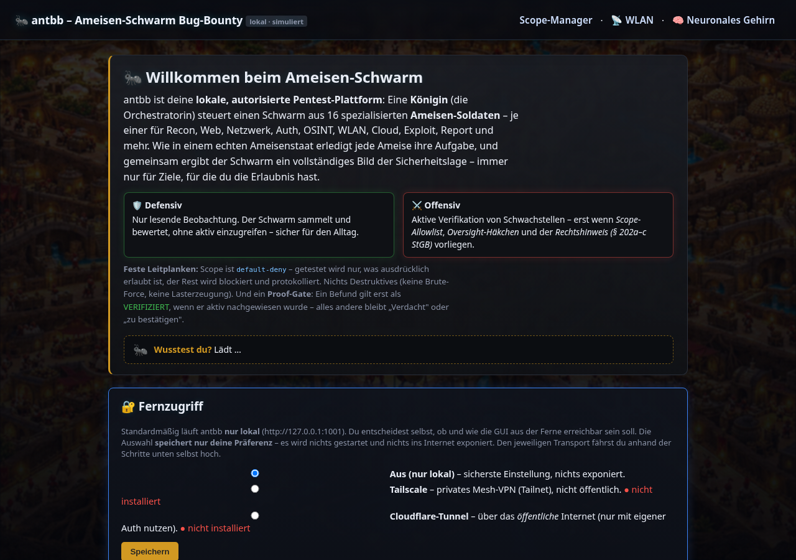
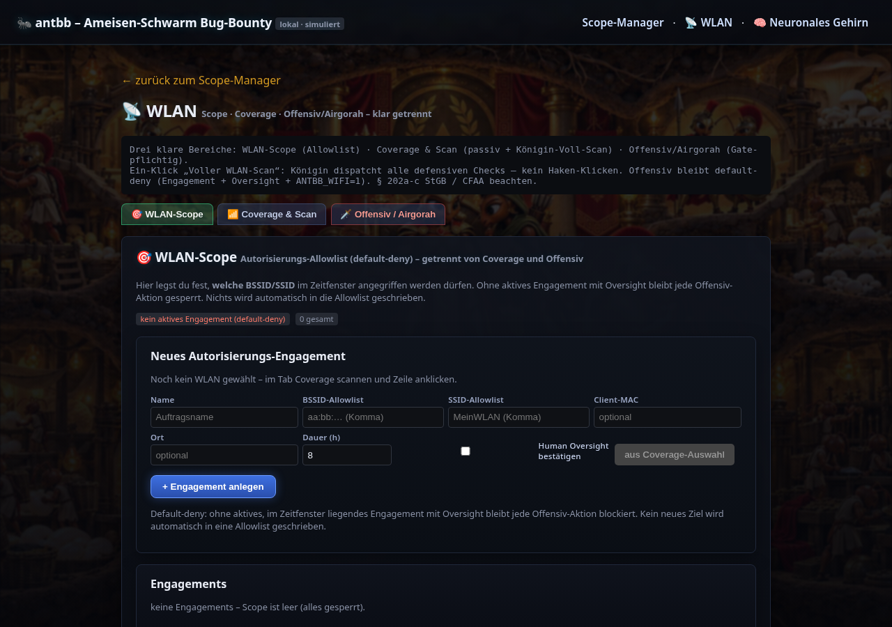
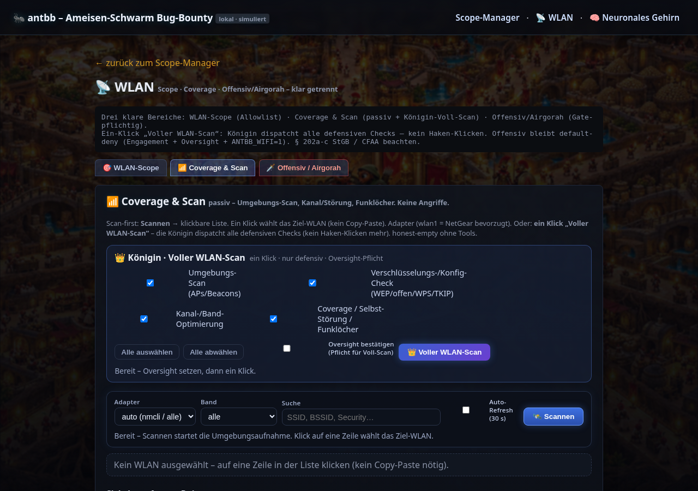
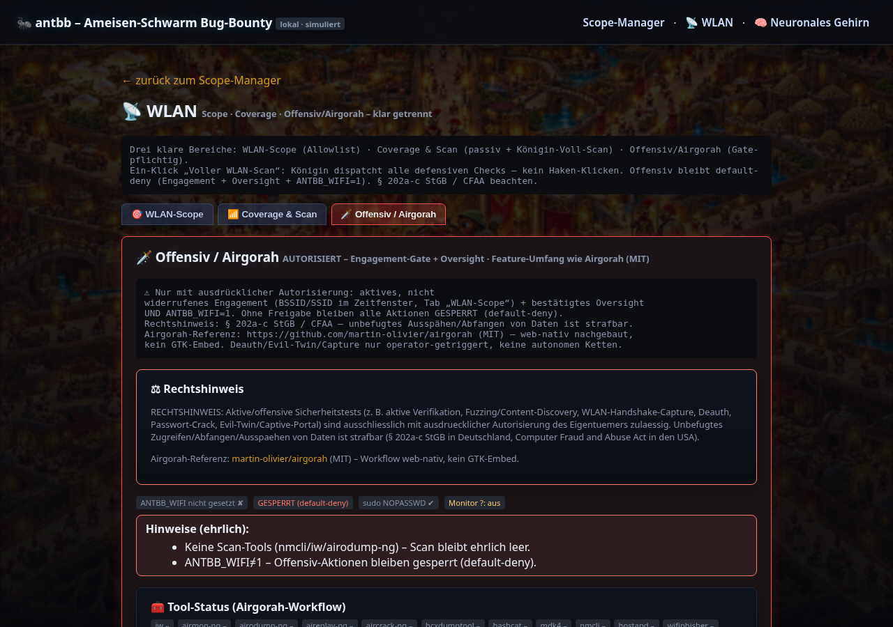
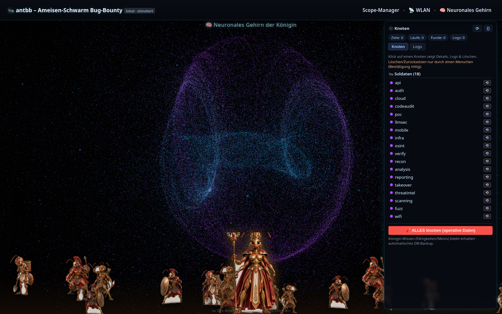

# 🐜 antbb – Ameisen-Schwarm Bug-Bounty / Pentest Framework (lokal)


-critical)
-informational)

> **Eine Königin, ein Schwarm aus 18 spezialisierten Ameisen-Soldaten.** antbb ist
> eine lokale, KI-gestützte Pentest-/Bug-Bounty-Plattform: Die Königin orchestriert
> den Schwarm über klare Phasen (Recon → Scan → Analyse → Report), hart abgesichert
> durch **default-deny Scope** und ein **Human-Oversight-Gate**. Läuft standardmäßig
> rein lokal unter `http://127.0.0.1` – nichts wird ohne deine Freigabe nach außen
> getragen.

## Funktionsumfang (vollständige Plattform)

> **Dies ist die VOLLSTÄNDIGE antbb-Plattform**, nur keyfrei und anonymisiert.
> Der Produktivcode liegt im Package `antbb/` (Königin, alle Agenten/Soldaten,
> WLAN-Scope/Coverage/Offensiv-Airgorah, Scope/Oversight/Proof-Gate, Web-
> Frontend+Backend, Neural-Brain, Reports). Die Dateien unter **`tests/`** sind
> nur Selbsttests (Smoke-Tests), **nicht** der Produktivcode. Eine komplette
> Datei-/Modulübersicht steht in **MANIFEST.md**.
>
> Enthalten u. a.: `queen.py` (Orchestrierung) · `agents/*` (recon, scanning,
> osint, auth, mobile, fuzz, poc, ssrf, takeover, verify, reporting, codeaudit,
> llmsec, threatintel, infra, cloud, wifi, analysis, api) · `wlan_survey.py` /
> `wlan_offensive.py` / `wlan_airgorah.py` · `scope`/`oversight`/`proofgate` ·
> `web/` (FastAPI-Backend + Templates + Static/Neural-Brain) · Reports/Rating.
>
> **Noch NICHT enthalten (ehrlich):** die **Blue Queen** (Verteidigungs-Königin)
> ist noch nicht gebaut und folgt separat – siehe Abschnitt „Roadmap".

## Schnellstart (neu hier?)

```bash
bash install-and-start.sh
# → Startseite z. B. http://127.0.0.1:1001/
```

Beim Start optional Key abfragen (Enter = ohne Key). Details: **INSTALL.md**. Secrets (Provider-API-Keys, Tunnel-Token) werden nur zur Laufzeit als Umgebungsvariablen gesetzt – nie eingebettet. Diese Distribution ist keyfrei und anonymisiert.

Ein **rein lokales** Framework zum Üben von Bug-Bounty-/Pentest-Workflows.
Es tritt **keiner** externen Plattform (HackerOne, Bugcrowd, …) bei und führt
**keine echten aktiven Angriffe** aus: alle Scanner-Agenten arbeiten mit
**simulierter, ungefährlicher Logik**. Der Kern ist die Software-Architektur
(Orchestrierung, Scope-Gate, Human-Oversight, Reports), nicht reales Angreifen.

> ⚠️ **Pflichthinweis:** Pentests/Bug-Bounty OHNE schriftliche oder öffentliche
> Autorisierung sind STRAFBAR (§ 202a-c StGB in DE, CFAA in US). Jede Aktion
> erfordert einen autorisierten Scope **und** eine manuelle Freigabe
> (Human-Oversight-Häkchen).

## Architektur

- **Gemeinsame Kern-Logik** im Package `antbb/` – CLI und Web nutzen dieselbe
  Service-Fassade (`antbb/service.py`). Keine Logik-Duplizierung.
- **Persistenz:** SQLite (`antbb/store.py`), DB unter `data/antbb.db`
  (überschreibbar via `ANTBB_DB`).
- **Scope-Gate** (`antbb/scope.py`): default-deny Allowlist; Out-of-Scope hat
  Vorrang. Jede aktive Aktion prüft jedes Asset.
- **Human-Oversight** (`antbb/oversight.py`): hartes Gate. Ohne Häkchen pro
  Target kein Scan und kein Report-Export – in CLI **und** Web.
- **Ameisen-Schwarm** (`antbb/agents/`, `antbb/queen.py`):
  - **Königin** (`Queen`): verteilt Aufgaben in Phasen (recon → scan →
    analyze → report), dispatcht Agenten-Gruppen **parallel (asyncio)**,
    sammelt Findings zentral, **dedupliziert** und **priorisiert**.
  - **Arbeiter-Ameisen** (gemeinsame Basisklasse `AntAgent`):
    `ReconAnt`, `ScanningAnt`, `ApiAnt`, `InfraAnt`, `FuzzAnt`,
    `AnalysisAnt`, `PocAnt`, `ReportingAnt`.
- **Reports** (`antbb/reports.py`): 8-Schritt-Evidence-Kette + CVSS,
  Speicherung als JSON im Store, Export nach Markdown/JSON.

## Verzeichnisstruktur

```
ameisen-bug-bounty-plattform/
├── antbb/                     # Produktivcode (Package)
│   ├── __init__.py  __main__.py  cli.py
│   ├── service.py             # gemeinsame Fassade (CLI + Web)
│   ├── store.py               # SQLite-Persistenz
│   ├── scope.py               # Allowlist-Prüfung (default-deny)
│   ├── oversight.py           # Pflicht-Häkchen-Gate
│   ├── active_oversight.py    # Freigabe-Gate für aktive/offensive Aktionen
│   ├── queen.py               # Ameisenkönigin / Orchestrator
│   ├── router.py  llm.py  oauth.py  prompts.py   # Multi-Provider-LLM + Auth
│   ├── reports.py  findingreport.py  brandedreport.py  rating.py
│   ├── attackpath.py  poc_builder.py  replay.py  proofgate.py
│   ├── brain_ops.py  registry.py  sdk.py  plugins/   # Neural-Brain + Erweiterbarkeit
│   ├── remote_access.py  egress_firewall.py  netutil.py
│   ├── wlan_survey.py  wlan_offensive.py  wlan_airgorah.py  wordlists.py
│   ├── codeaudit.py  config.py  telemetry.py  disclaimer.py
│   ├── agents/                # Basisklasse + 20 Spezial-Soldaten
│   │   ├── base.py recon.py scanning.py api.py infra.py fuzz.py
│   │   ├── analysis.py poc.py reporting.py auth.py osint.py cloud.py
│   │   ├── mobile.py codeaudit.py llmsec.py threatintel.py verify.py
│   │   ├── ssrf.py takeover.py wifi.py  skills/
│   │   └── …
│   ├── tools/                 # Kali-Tool-Adapter-Schicht
│   └── web/
│       ├── app.py             # FastAPI: HTML + JSON-API
│       ├── templates/         # base/index/target/brain/wlan/trash.html
│       └── static/            # Style, Neural-Brain-Assets
├── tests/                     # nur Smoke-/Selbsttests (NICHT Produktivcode)
├── docs/screenshots/          # Galerie (nur Repo, nicht in der ZIP)
├── config/                    # default.yaml (Provider-URLs, Router-Schwellen)
├── install-and-start.sh       # robuster 1-Befehl-Installer (= install.sh)
├── run.sh  run_web.py  requirements.txt
├── MANIFEST.md  INSTALL.md  antbb.env.example
└── data/                      # SQLite-DB + Exporte (gitignored)
```

## Installation

```bash
cd ameisen-bugbounty
python3 -m venv .venv
source .venv/bin/activate
pip install -r requirements.txt
```

## CLI starten

Modul-Aufruf (`python -m antbb`). Beispiel-Workflow:

```bash
source .venv/bin/activate

# Target + Scope
python -m antbb target add example.com -d "Demo"
python -m antbb scope add example.com domain '*.example.com'
python -m antbb scope add example.com url 'http://api.example.com/*'
python -m antbb scope add example.com domain 'secret.example.com' --out   # Out-of-Scope
python -m antbb scope list example.com
python -m antbb scope check example.com http://api.example.com/users      # ERLAUBT
python -m antbb scope check example.com http://secret.example.com/        # BLOCKIERT

# Human-Oversight (Pflicht)
python -m antbb scan example.com            # -> BLOCKIERT (kein Häkchen)
python -m antbb oversight set example.com on --by OPERATOR
python -m antbb oversight status example.com
python -m antbb scan example.com            # -> läuft (Schwarm)

# Findings & Reports
python -m antbb findings example.com
python -m antbb report create example.com "IDOR in Orders-API" --cvss 7.5 \
    --vector "CVSS:3.1/AV:N/AC:L/PR:L/UI:N/S:U/C:H/I:N/A:N"
python -m antbb report list example.com
python -m antbb report show 1
python -m antbb report export 1 --format md     # Gate: braucht Häkchen
python -m antbb report export 1 --format json
```

Eigene DB: `python -m antbb --db /pfad/zur.db ...` oder `ANTBB_DB=...`.

## Webserver starten

```bash
source .venv/bin/activate
python run_web.py
# -> http://127.0.0.1:8000
```

- **HTML-Oberfläche:** `/` (Scope-Manager), `/target/{id}`
  (Oversight, Scope, Swarm-Control, Findings-Feed, Report-Builder).
- **JSON-API:** `/api/health`, `/api/targets`, `/api/targets/{id}/scopes`,
  `/api/targets/{id}/scope-check?asset=...`, `/api/targets/{id}/oversight`,
  `/api/targets/{id}/scan`, `/api/feed`, `/api/targets/{id}/findings`,
  `/api/targets/{id}/reports`.

Der Scan-Button ist deaktiviert, solange das Oversight-Häkchen fehlt; die
API antwortet dann mit **HTTP 403**.

## Sicherheits-/Design-Garantien

1. **Default-deny Scope:** ohne In-Scope-Eintrag wird jedes Asset blockiert.
2. **Oversight-Gate hart:** `OversightError` blockiert Scan + Export.
3. **Nur Simulation:** Agenten erzeugen deterministische Platzhalter-Findings,
   es werden keine echten Netzwerk-Requests gegen Ziele ausgeführt.
4. **Zentrale Dedup/Priorisierung** durch die Königin.

## LLM-Connector (optional)

Das Framework kann Königin und Agenten **optional** von einem LLM unterstützen
lassen. Modul: `antbb/llm.py` (+ austauschbare Adapter in `antbb/llm_providers.py`).

- **LLMs sind nur austauschbare Denk-/Text-Bausteine.** Sie fassen Findings
  zusammen, priorisieren oder formulieren Report-Narrative – mehr nicht.
- **Keys werden AUSSCHLIESSLICH aus Umgebungsvariablen gelesen** und niemals
  geloggt, geechot, in die DB oder in Reports geschrieben. Es ist **kein** Key
  und **kein** Account im Repo hinterlegt.
- **Optionaler Schritt mit Fallback:** Ohne konfigurierten Provider läuft alles
  wie bisher (deterministischer Fallback). Das Human-Oversight-Gate bleibt in
  jedem Fall unangetastet.

## Multi-Provider-LLM-Router

> **ZENTRALE REGEL:** Kein einzelnes LLM aktiviert von sich aus einen Schwarm.
> Das Schwarm-Verhalten (Königin + Spezial-Agenten, Phasen, Dispatch) kommt
> **ausschließlich aus dem antbb-Framework**. Die LLMs sind nur austauschbare
> Denk-/Text-Bausteine, die der Router pro Aufgabe aufruft.

Der **Multi-Provider-LLM-Router** (`antbb/router.py`) ist eine austauschbare
Schicht, die pro Aufgabe **ein** LLM auswählt und aufruft:

- Kleine/schnelle Arbeiter-Schritte → günstiges/schnelles Modell.
- Entscheidungs-/komplexe Aufgaben (tiefe Analyse, Report-Narrativ) → stärkeres
  Modell.
- Bei kritischen oder mehrdeutigen Entscheidungen fragt der Router den Nutzer
  (`UserQuery`), statt still selbst zu wählen.

antbb **unterstützt mehrere austauschbare LLM-Provider** (Cloud-APIs per Key
oder lokale Modelle über eine einheitliche `chat()`-Adapter-Schnittstelle).
**Welche Provider konkret genutzt werden, konfiguriert jede Installation selbst
über Umgebungsvariablen** – nichts davon ist im Repo hinterlegt. Nur Provider,
für die zur Laufzeit ein Key gesetzt ist (bzw. bei einem lokalen Dienst dieser
erreichbar ist), werden als „verfügbar" gelistet; fehlt der Key/Dienst, wird der
Provider sauber übersprungen (kein Crash).

**Authentifizierung:** Der Router unterstützt **API-Key-Authentifizierung** und –
wo der jeweilige Provider es offiziell anbietet – zusätzlich **OAuth** (OAuth 2.0
Authorization Code mit PKCE für browserbasierte Anmeldung sowie den
Device-Authorization-Grant/Device-Code-Flow für Anmeldung ohne lokalen Browser).
Pro Provider ist die Methode wählbar (`auth_method: api_key | oauth`); Provider
ohne dokumentierten OAuth-Flow bleiben key-only. Keys, OAuth-Client-Secrets und
Tokens kommen **ausschließlich zur Laufzeit** (Umgebungsvariablen bzw. lokaler,
verschlüsselter Token-Store) – **nichts davon ist im Repo hinterlegt**, und
fehlende Credentials führen zu sauberem Überspringen statt zum Absturz.

Provider-Status in der Oberfläche (zeigt **nie** Key-/Token-Werte):

- **CLI:** `python -m antbb llm status`
- **Web:** `GET /api/llm/status` (JSON) und HTML-Ansicht unter **`/providers`**.

## Umgesetzt / Roadmap

Umgesetzt:

- ✅ Echter WebSocket-Live-Feed (`/ws/feed`) mit automatischem Fallback auf das
  `/api/feed`-Polling.
- ✅ Interaktiver CVSS-v3.1-Rechner (`antbb/cvss.py`, `GET /api/cvss`).
- ✅ Optionale Authentifizierung/Multi-User für den Webserver (`ANTBB_AUTH=1`,
  Rollen admin/viewer; Standard: Einzelnutzer-Betrieb ohne Login).
- ✅ Opt-in-Modul für *echte* ungefährliche Checks (TLS/HTTP-Security-Header)
  nur gegen ausdrücklich bestätigte **eigene** Assets (default-deny,
  oversight-gated).
- ✅ Persistente Run-Historie + Export-Index in der UI (`/history`).
- ✅ Startseiten-Laufschrift **„Neueste Schwachstellen"** (`GET /api/dyk`):
  echte, aktuelle CVEs (NVD) und öffentliche Mastodon-Infosec-Posts
  (Instanz/Hashtags/Konten in `config/default.yaml` konfigurierbar, kein Login)
  als durchlaufende Laufschrift + ausklappbare Späher-Liste. Cache mit TTL;
  bei Netzausfall sauberer Fallback auf statische Infosec-Fakten (nie dauerhaft
  „Lädt …"). Optik im Ameisen-/Schwarz-Theme inkl. Scout-Ameisen entlang der
  Laufschrift; im Kolonie-Tunnel laufen animierte Ameisen zum Ziel.


Offen / Ideen:

- Weitere LLM-Adapter und Feinschliff der Router-Heuristiken.

## On-Device GUI (ohne CLI-Copy-Paste)

Die Web-GUI steuert die Königin **vollständig lokal** über `AntBBService`
(Scope, Oversight, Mode-Policy, Scan, Report). Es gibt **keine** Fernsteuerung
von Termux durch einen externen Assistenten und **keine** Ausführung beliebiger
Shell-Kommandos – nur fest verdrahtete Python-Operationen.

### Ein-Tipp-Start

```bash
./run.sh
# öffnet http://127.0.0.1:8000/
```

Oder: `python run_web.py`

### Mode-Policy

Pro Target: `defensive` | `auto` | `offensive`.
Offensiv (`--active` / `--fuzz` bzw. GUI-Checkboxen) greift nur bei
**Scope + Oversight**. Bei `defensive` werden Offensiv-Flags verworfen.

### Pixel / Termux und Python 3.14

FastAPI/pydantic bauen unter **Python 3.14** in Termux oft nicht.
Saubere Lösungen:

1. Termux-Python **3.12** nutzen (falls verfügbar), dann `pip install -r requirements.txt` und `./run.sh`
2. Oder **CLI-only** ohne Web: `python -m antbb …` (pydantic-frei)

Die Autonomie ist on-device: App startet lokal, GUI + Königin erledigen den Rest.

## Secrets & Environment (Distribution)

Siehe **`INSTALL.md`** und **`antbb.env.example`**.

Kurz: Provider-API-Keys und der `CLOUDFLARE_TUNNEL_TOKEN`
werden **ausschließlich zur Laufzeit** als Umgebungsvariablen gesetzt und
**niemals** in ZIP/Repo/APK/Logs eingebettet. Es wird **keine** leere Key-Variable angelegt.


## System-Bootstrap durch den Installer

`install-and-start.sh` (= `install.sh`) richtet auf einem frischen System so
viel wie möglich automatisch ein:

- **Basis (immer, best effort):** `python3`, `python3-venv`, `python3-pip`,
  `build-essential`, `git`, `curl` – via erkanntem Paketmanager (apt, optional
  dnf/pacman). Non-interaktiv (`DEBIAN_FRONTEND=noninteractive apt-get -y`).
- **`ANTBB_FULL=1`:** zusätzlich die vom Code **real erwarteten** externen Tools
  und Wortlisten (keine erfundenen):
  - Netz/Web: `nmap`, `iw`, `network-manager` (nmcli), `ffuf`, `gobuster`,
    `nikto`, `wpscan`
  - WLAN-Offensiv (gate-pflichtig): `aircrack-ng`-Suite (airmon-ng/airodump-ng/
    aireplay-ng), `hcxdumptool`, `hashcat`, `mdk4`
  - Wortlisten: `seclists` und `wordlists` (rockyou) an die in
    `antbb/wordlists.py` erwarteten Pfade (`/usr/share/seclists`,
    `/usr/share/wordlists/rockyou.txt`).
- **`ANTBB_SKIP_SYSTEM=1`:** keine System-Installation, nur Python/venv/Web.

**Rechte:** als root direkt, sonst via `sudo`. Fehlen root **und** sudo, bricht
der Installer **nicht still** ab, sondern listet die fehlenden Pakete + den
exakten Install-Befehl auf und startet trotzdem den Python-/Web-Teil
(tool-abhängige Funktionen bleiben dann „ehrlich leer", bis die Pakete da sind).
Idempotent: vorhandene Tools werden übersprungen; einzelne Paketfehler brechen
den Lauf nicht ab; am Ende erscheint eine Zusammenfassung
„installiert / übersprungen / fehlgeschlagen".

> **Python-Version:** empfohlen 3.11–3.13 (FastAPI/pydantic bauen damit
> zuverlässig). Ubuntu 24.04 liefert 3.12 als Standard. Unter 3.14/3.15 kann
> pydantic/FastAPI fehlen – der Installer warnt dann klar.

### Handshake-/Capture-Dateien (bewusst KEINE mitgeliefert)

Diese Distribution enthält **keine** WLAN-Handshakes/Traffic-Captures – weder
echte noch fremde Samples (keine PII, nichts aus Produktivsystemen). Für
autorisierte, offline Crack-Übungen bringt der Nutzer **eigene**, selbst
erzeugte oder offiziell/frei lizenzierte Test-Captures mit und legt sie lokal
ab. Es wird nichts dergleichen erfunden oder automatisch heruntergeladen.

## Telemetrie (optional, anonym, standardmäßig AUS, abschaltbar)

antbb kann **optional** anonyme Nutzungs-Signale senden – **standardmäßig ist
das AUS**. Es wird **nichts** gesendet, solange `ANTBB_TELEMETRY_URL` leer ist.
Nichts davon ist getarnt; die Logik steht offen in `antbb/telemetry.py`.

- **Was** (exakter Payload, JSON): `{"event": "<install|heartbeat>",
  "version": "<antbb-Version>", "ts": <unix-sekunden>}`. **Keine** PII, **keine**
  API-Keys, **keine** Hostnamen/Usernamen/IPs im Body.
- **Wann:** `install` einmalig beim Lauf von `install-and-start.sh`;
  `heartbeat` periodisch vom laufenden Web-Server (Intervall via
  `ANTBB_TELEMETRY_INTERVAL`, Default 6 h) – nur „aktiv", keine Nutzungsdetails.
- **Wohin:** an die vom **Betreiber selbst** gesetzte `ANTBB_TELEMETRY_URL`
  (oben im Script als offene Variable). Die rohe Absender-IP sieht technisch
  nur dieser Endpunkt (wie bei jedem HTTP-Request) – hier offengelegt.
- **Aus-/Anschalten:** leere `ANTBB_TELEMETRY_URL` = komplett aus (Default).
  Zusätzlich `ANTBB_TELEMETRY=0` als harter Aus-Schalter. Beim ersten Start und
  im Installer erscheint ein klarer Konsolen-Hinweis zum Status (AN/AUS).
- **Fehlertolerant:** kurzes Timeout (3 s), Fehler werden still geschluckt;
  Telemetrie blockiert Start/Betrieb nie.

## Lizenz

Für dieses Repository ist derzeit **keine Open-Source-Lizenz hinterlegt**. Ohne
explizite Lizenz gelten die gesetzlichen Standardrechte, d. h. alle Rechte liegen
beim Autor (`krockodog`). Wer den Code über das reine Ansehen hinaus nutzen,
anpassen oder weitergeben möchte, klärt das bitte vorab mit dem Autor. Eine
passende `LICENSE`-Datei (z. B. MIT) kann jederzeit ergänzt werden.

## 🐜 Vision

antbb beginnt mit **einem** Volk — der offensiven Königin und ihren Spähern, Spezialisten und Soldaten, die autorisierte Ziele aufklären, Schwächen aufspüren und beweisen, niemals zerstören. Doch ein einzelnes Volk ist erst der Anfang.

**Das Blue-Team-Volk.** Neben die angreifende Königin tritt eine **verteidigende Königin** mit ihrem eigenen Ameisenvolk: Härtungs-Ameisen, die Funde direkt in Fixes übersetzen, Wächter-Ameisen, die Erreichbarkeit und Veränderungen überwachen, und Sanitäter-Ameisen, die aus jedem Angriff eine konkrete Gegenmaßnahme bauen. Was das rote Volk findet, verschließt das blaue Volk — im selben Bau, mit demselben Gedächtnis.

**Das Reverse-Engineering-Volk.** Ein drittes Volk gräbt tiefer: Zerleger-Ameisen, die Binärdateien, Firmware und Protokolle auseinandernehmen, Spuren-Ameisen, die Logik rekonstruieren, und Übersetzer-Ameisen, die aus rohem Code verständliche Erkenntnis machen. Sie verstehen, *wie* Dinge gebaut sind — damit die anderen Völker wissen, wo sie ansetzen.

**Die Verschmelzung.** Jedes Volk hat heute seinen eigenen Bau. Die Vision ist, dass die Völker nicht nebeneinander leben, sondern **zu einer einzigen Plattform verschmelzen**: ein gemeinsames Gedächtnis, in dem jede Ameise vom Wissen aller anderen lernt. Der Angreifer weiß, was der Verteidiger gehärtet hat; der Verteidiger weiß, was der Zerleger entdeckt hat; der Zerleger weiß, wonach der Angreifer sucht. Ein Schwarm, viele Kasten, ein Bau.

Verspielt im Auftritt — lebendige Ameisen, die über den Bildschirm wuseln — aber mit echter, gebündelter Kraft darunter. Das Ziel: nicht viele kleine Werkzeuge, sondern **ein großes, zusammengewachsenes Framework**, in dem autorisierte Sicherheitsarbeit, Verteidigung und Verständnis als ein einziger, koordinierter Organismus funktionieren. Immer nachvollziehbar, immer unter menschlicher Aufsicht, immer nur im erlaubten Rahmen.

## Roadmap / noch nicht enthalten

- **Blue Queen (Verteidigungs-Königin):** noch **nicht gebaut**, folgt als
  separater Job (u. a. lokaler, nicht-destruktiver CVE-Lab-Fall mit Detection +
  automatischem Fix und Vorher/Nachher-Nachweis). In dieser ZIP ist **kein**
  Blue-Queen-Code enthalten und es wird keiner vorgetäuscht.

## Screenshots (nur Repo)

> Diese Galerie liegt nur im privaten Repo unter `docs/screenshots/`.
> Die geteilte ZIP enthält diesen Abschnitt bewusst NICHT (keine kaputten Links).


*Startseite der antbb-Web-GUI – Königin-Steuerung, Ziel-/Scope-Übersicht.*


*WLAN-Scope: autorisierte SSIDs/APs als default-deny Allowlist.*


*Coverage & Scan: passives Site-Survey, Kanal-/Funkloch-Analyse.*


*Offensiv/Airgorah-Tab: gate-pflichtige WLAN-Aktionen (Monitor/Handshake/Crack).*


*Orchestrator-Ansicht „Neuronales Gehirn der Königin": sichtbares Ameisenvolk – die Königin mittig, die 18 Soldaten krabbeln als Ameisen-Sprites darum herum und leuchten bei Aktivität/Funden auf.*

### Installer-Konsole (Transkripte)

Die CLI-Schritte liegen als echte Konsolen-Transkripte bei:

- [`docs/screenshots/cli_provider_prompt.txt`](docs/screenshots/cli_provider_prompt.txt) – Installer: interaktive KI-Anbieter-Abfrage (API-Key oder OAuth, überspringbar).
- [`docs/screenshots/cli_telemetry_notice.txt`](docs/screenshots/cli_telemetry_notice.txt) – Klarer Konsolen-Hinweis: Telemetrie standardmäßig AUS, abschaltbar.
- [`docs/screenshots/beispiel_test_transkript.txt`](docs/screenshots/beispiel_test_transkript.txt) – vollständiges Transkript eines lokalen Beispiel-Scans (Scope → Oversight → Scan → Findings → Report).